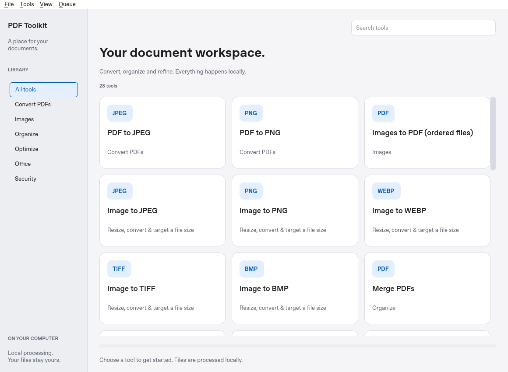

# Local PDF Toolkit



**[Download the Windows app](https://github.com/cell849/tools/releases/latest)**

On the release page, expand **Assets** and download **LocalPDFToolkit-Windows-x64.zip**.
Extract it once, open the LocalPDFToolkit folder, and launch LocalPDFToolkit.exe.
Keep `_internal` beside it. GitHub sign-in is required for this private repository.
The automatically listed “Source code” ZIP is for development.


A Windows 11-first, personal-use desktop application for fully local PDF and
image tools. **31 local tools** cover PDF/image conversion, PDF page operations,
compression and optional Office conversion. See CAPABILITIES.md for exact support
and fidelity limits. Drag-and-drop, options, progress and cancellation are included.
Rendering uses a separate process; multiple imported PDFs run sequentially.

## Run on Windows 11

Install 64-bit Python 3.13 from python.org, extract this project, and open
PowerShell in its folder:

```powershell
py -3.13 -m venv .venv
.\.venv\Scripts\python.exe -m pip install -e ".[dev]"
.\.venv\Scripts\python.exe -m local_pdf_toolkit
```

These commands use the environment's Python directly; no PowerShell execution
policy change or activation is needed. For running without development tools,
install with `-e .` instead of `-e ".[dev]"`. The installed
`.\.venv\Scripts\local-pdf-toolkit.exe` launcher also opens the app.

Installation downloads dependencies. Once installed, the application requires
no account, API key, network access, or AI service. It contains no upload,
telemetry, or update mechanism.

## Verify

```powershell
.\.venv\Scripts\python.exe -m ruff check .
.\.venv\Scripts\python.exe -m ruff format --check .
.\.venv\Scripts\python.exe -m pytest
.\.venv\Scripts\python.exe -m build
```

Tests use Qt's offscreen platform and synthetic files. To verify the actual
desktop on Windows, launch normally, confirm both rendering tools appear, convert a PDF, resize the window, and close it. GitHub Actions is configured for Python 3.13
on Windows and Linux; a workflow configuration is not a completed Windows test.

Linux development equivalent:

```sh
python3.13 -m venv .venv
.venv/bin/python -m pip install -e '.[dev]'
.venv/bin/python -m pytest
.venv/bin/python -m local_pdf_toolkit
```

Headless Linux requires `QT_QPA_PLATFORM=offscreen` for a GUI smoke run;
normal interactive launch requires a desktop and Qt system libraries.
`python -m local_pdf_toolkit --self-test` checks conversion with a spawned worker.

## Convert a PDF

1. Add PDFs or drop local files into the window.
2. Select PDF to JPEG or PDF to PNG. Choose pages (`all` or `1,3-5`),
   72/150/300 DPI, and quality (JPEG) or transparency (PNG).
3. Choose an existing output folder and press Convert.
4. Follow each file's status. Open the output folder to view results.

Images rasterize text and vectors: text is no longer selectable. JPEG uses RGB
and a white background; PNG optionally preserves transparency. Page ranges are
rendered once each, in original document order. Names use original page numbers,
for example `report_page-0003.jpg`.

Originals remain unchanged. Images are staged in a temporary folder on the
output filesystem, then published with atomic hard links that refuse existing
names. If the filesystem does not support hard links, conversion fails safely;
use a local NTFS folder. A collision fails that PDF without overwriting files.
Completed images from earlier PDFs remain if a later PDF fails or is cancelled.
Cancellation removes the current PDF's staged/published outputs and stops the
remaining files. It is cooperative between pages; a native render/encode call
must finish before cancellation or closing completes. Hard process termination,
power loss or OS crashes can leave temporary or partial job outputs; crash
recovery and forced cancellation are not implemented.

The app rejects encrypted, empty, malformed/repaired PDFs, files above 512 MiB,
documents above 10,000 pages and rendered pages above 40 million pixels. Try lower
DPI for large pages. These limits reduce resource use; they are not a security
sandbox or an absolute memory/time limit on native PDF parsing.

## Architecture and next steps

- `core/contracts.py`: adapter capabilities, options, progress and cancellation.
- `core/registry.py`: explicit adapter registration and discovery.
- `core/output.py`: same-filesystem staging, no-replace publication and rollback.
- `core/jobs.py`: one spawned conversion process and Qt message polling.
- `converters/pdf_images.py`: validated PDF rendering with PyMuPDF.
- `ui/main_window.py`: registry-driven options, import, status and output access.
- `tests/`: synthetic rendering, output safety, worker and Qt interaction tests.
- `VERIFICATION.md`: checks performed and platform limitations.

M2, M3 and M5 are implemented. Move files up/down before merging or creating an
image PDF. Single-input tools run each file as a separate job; multi-input tools
combine the entire list. Cancel selected affects that job; Cancel stops the batch.
Retry failed/cancelled reuses the previous job options. Double-click a completed
file row to open its first result. Tool search filters the available operations.

For Office → PDF, install LibreOffice locally on Windows. It is detected in PATH
or the standard Program Files location. It is not bundled. See CAPABILITIES.md
for restrictions. Reverse Office exports require no LibreOffice but are lossy.

PDF compression has lossless and explicitly rasterized modes. Image converters
have maximum width/height and KiB controls. Targets are upper bounds and can
require reduced quality/resolution; no promise of exact byte size is made.

Reproduce the 100-page baseline with:

```powershell
.\.venv\Scripts\python.exe benchmarks/benchmark_pdf_images.py --report benchmark.json
```

M4 build instructions and platform limits are in packaging/README.md.

Runtime dependencies are pinned in pyproject.toml. `uv.lock` records the full
resolved dependency set; contributors with uv can use `uv sync --extra dev
--frozen`. Pip commands above pin direct dependencies, but do not consume the
uv lock. The build produces Python packages, not a Windows standalone installer.

No distribution license has been selected. Keep this project for personal use
until that decision and dependency-license review are complete. PyMuPDF is
AGPL/commercial dual-licensed; review its terms before distributing this app.

## Confirmed decisions

- Target: Windows 11 first.
- Working name: Local PDF Toolkit.
- Distribution: personal use.
- Output policy: originals remain unchanged, user-selected output directory,
  temporary outputs and no unapproved overwrite (implemented in M1).
- AI policy: one agent by default; no model switching is implied by this repo.

The v0.3 desktop UI uses an Apple-inspired tool library, category sidebar and focused
workspaces. See docs/DESIGN.md for design decisions and keyboard shortcuts.


Metadata cleaning is in the **Privacy** category: images, supported editable
PowerPoint files and flattened PDFs. Each clean copy has a neutral filename and
an integrated cleaning report. See [metadata support and limits](docs/METADATA.md)
before use; visible personal content is not automatically anonymized.
