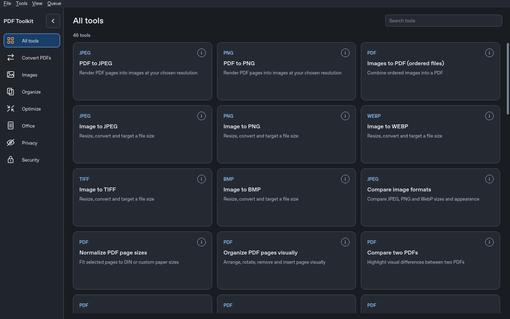

# PDF Toolkit

A Windows 11 desktop app for working with PDFs, images and document metadata.
Files are processed on your computer without uploads or an account.



*Current interface preview, rendered from the app on Linux; Windows window chrome may differ.*

## Download for Windows

1. Open the [latest release](https://github.com/cell849/PDF-Toolkit/releases/latest).
2. Download **PDFToolkit.zip**, not the automatically generated source archives.
3. Extract the ZIP and open `PDFToolkit.exe` in the extracted `PDFToolkit` folder.
   Keep the `_internal` folder beside it.

The download is portable and has no installer. The executable is self-signed:
Windows may warn that the publisher is untrusted. The release notes include a
SHA-256 checksum. Python is bundled; optional tools listed below are not.

Use **File → Add to Start menu…** or **File → Add Desktop shortcut…** to create
shortcuts when wanted. Existing shortcuts are not overwritten. If you move the
app folder, delete and recreate the shortcuts. To remove the app, delete the
extracted folder and any shortcuts; preferences and interrupted-job records may
remain in your user profile. See [packaging notes](packaging/README.md).

## What it does

- Convert PDF pages to JPEG or PNG, images to PDF, and images between formats.
- Resize images and set file-size targets or percentages; compare image formats.
- Merge, split, extract, reorder and visually organize PDF pages; normalize page
  sizes, add page numbers or watermarks, and compare PDFs.
- Compress, password-protect, unlock, flatten and redact supported PDFs.
- Clean or inspect metadata in supported images, documents and media. Metadata
  cleaning is not universal anonymization: visible content and other personal
  information may remain. See [metadata limits](docs/METADATA.md).
- Convert supported Office and text files to PDF, export PDF text or Office
  formats, batch-rename copies and inspect document details.

[Capabilities and limitations](CAPABILITIES.md) lists the supported formats,
operations, output fidelity and privacy limits. Some conversions are lossy: PDF
pages exported as images no longer have selectable text, and Office exports do
not preserve every layout or element.

### Optional tools

- **LibreOffice**: Office and supported text formats → PDF.
- **Tesseract and language packs**: searchable PDF OCR.
- **FFmpeg / ffprobe**: supported audio and video metadata inspection and cleaning.

Install these separately if you need them. The app does not download them.

## Using the app

Choose a category or search for a tool, add files, choose its options and an output
folder, then run the job. Originals are kept unchanged and outputs do not replace
existing files. Jobs run in a separate process; cancellation is cooperative and a
native operation may need to finish first.

After an interrupted job, **Tools → Clean up interrupted jobs…** lets you review
and remove recognized temporary files. It keeps published outputs and does not
resume jobs automatically. Unrecognized or unsafe leftovers may require manual
review. See [recovery details](docs/TOOLS_FOLLOWUP.md).

## Develop and test

On Windows, install 64-bit Python 3.13, open PowerShell in the project folder,
and run:

```powershell
py -3.13 -m venv .venv
.\.venv\Scripts\python.exe -m pip install -e ".[dev]"
.\.venv\Scripts\python.exe -m local_pdf_toolkit
.\.venv\Scripts\python.exe -m pytest
```

For optional HEIC/HEIF support, install `.[dev,media]` instead. The source checkout
needs its Python dependencies installed; the Windows ZIP does not. Additional
build instructions and release verification are in [packaging/README.md](packaging/README.md).

## License

The project's code is licensed under the [GNU General Public License version 3.0 only](LICENSE)
Previously released versions remain available under their original terms.

The app uses PyMuPDF under AGPL-3.0, so the combined app has AGPL obligations
when distributed. Other dependencies have their own terms; see
[third-party notices](packaging/THIRD_PARTY.md).
